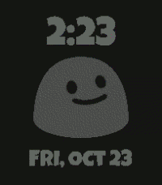

# party blob for Pebble Time 2



## build instructions
Install [uv](https://docs.astral.sh/uv/) and run:

```
uv tool install pebble-tool
pebble sdk install latest
```
if you haven't already.

Clone the repo and build:

```
git clone https://github.com/nubbybubby/partyblob-watchface
cd partyblob-watchface
pebble package install @rebble/clay
pebble build
```

the .pbw file will be in the build directory.
